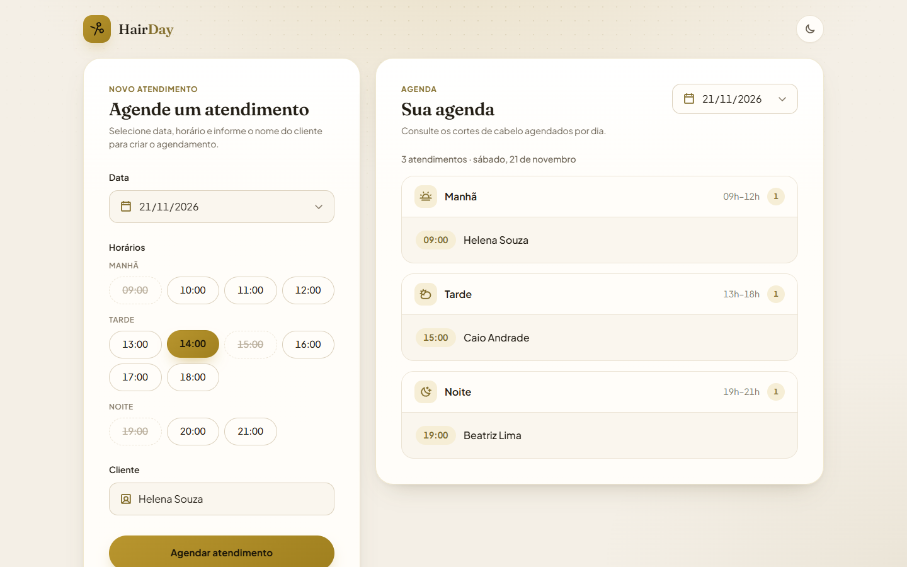
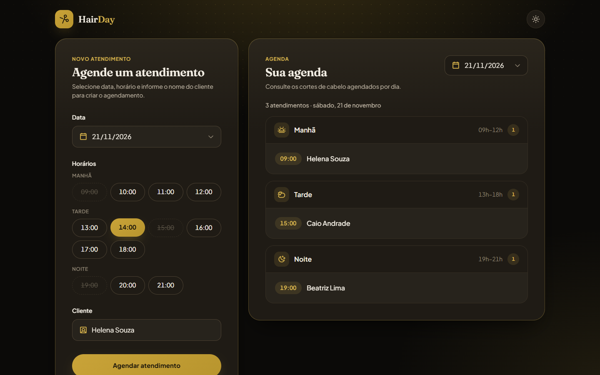
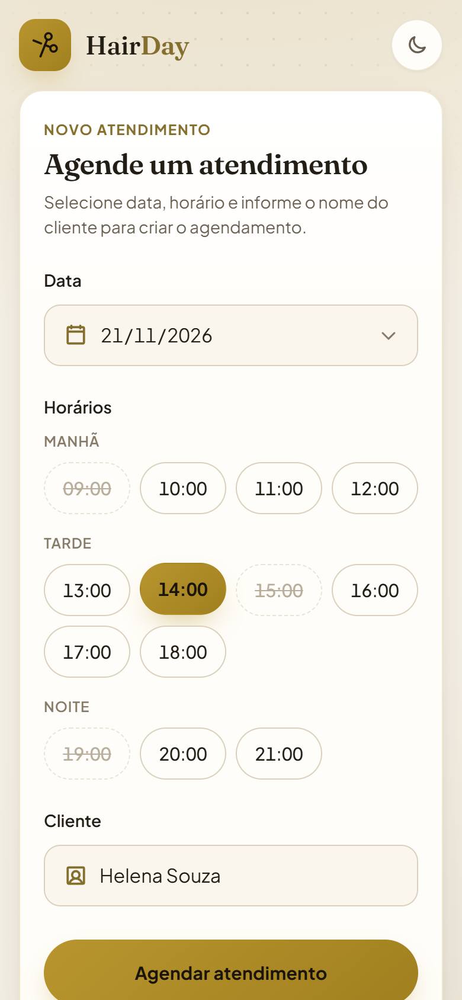
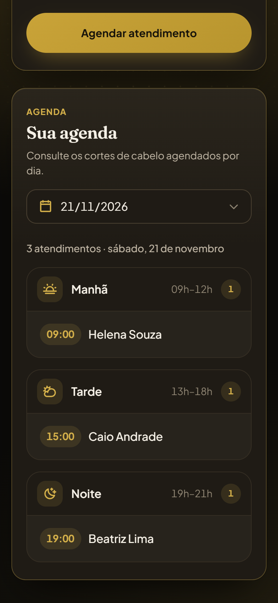
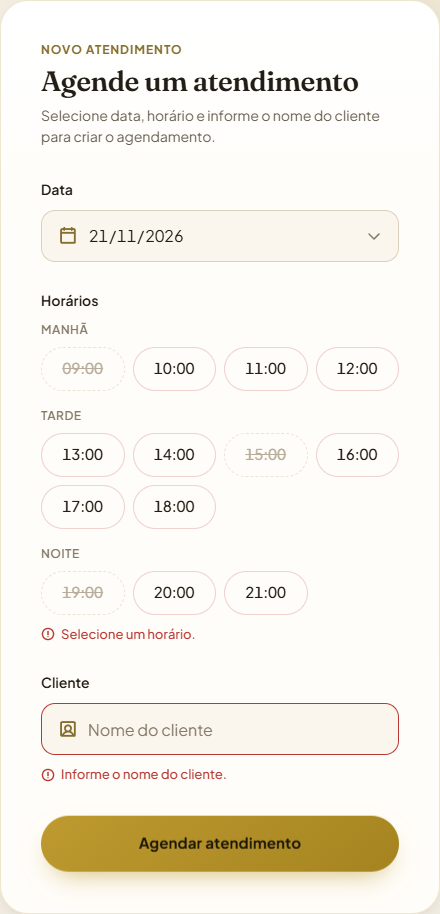
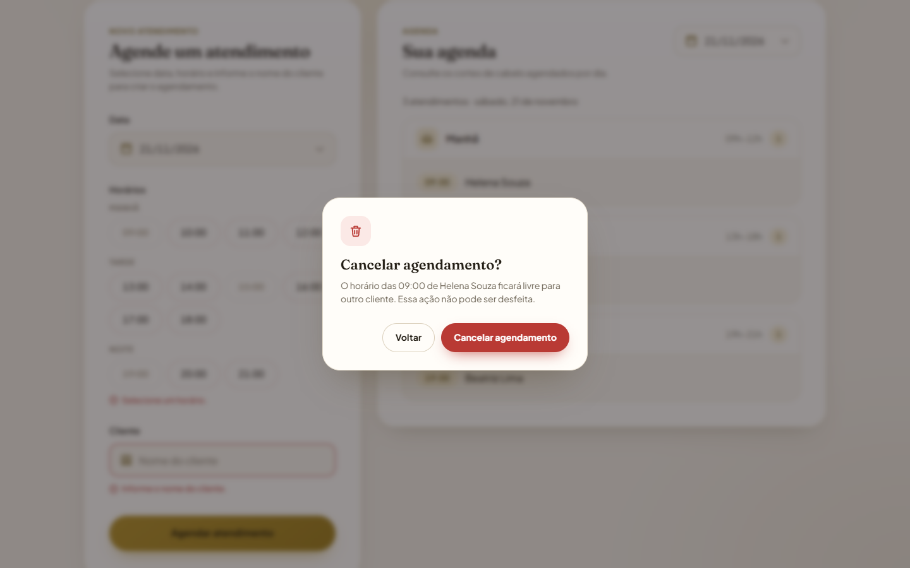

# Hair Day

<p align="center">
  <strong>Plataforma de agendamento para salões de beleza, com formulário validado e integração a uma API REST.</strong>
</p>

<p align="center">
  
  
  
  
  
  
</p>

<p align="center">
  <a href="#demonstração-visual">Demonstração visual</a> •
  <a href="#funcionalidades">Funcionalidades</a> •
  <a href="#integração-com-a-api">Integração com a API</a> •
  <a href="#design">Design</a> •
  <a href="#tecnologias">Tecnologias</a> •
  <a href="#estrutura-de-pastas">Estrutura de pastas</a> •
  <a href="#pré-requisitos">Pré-requisitos</a> •
  <a href="#execução">Execução</a> •
  <a href="#testes">Testes</a> •
  <a href="#decisões-técnicas">Decisões técnicas</a> •
  <a href="#validações-realizadas">Validações realizadas</a> •
  <a href="#autora">Autora</a>
</p>

---

O **Hair Day** é uma aplicação para salões de beleza organizarem seus atendimentos. Em uma única tela, é possível **agendar um corte** escolhendo data, horário e cliente, e **consultar a agenda de qualquer dia**, separada por manhã, tarde e noite, com a opção de cancelar agendamentos.

O projeto foi construído com **JavaScript puro (ES Modules)**, sem frameworks, com foco em **formulários** (validação, acessibilidade e estados de envio) e **integração com API REST** (`GET`, `POST` e `DELETE` com `fetch`). O layout parte do modelo *Plataforma de agendamento*, disponível na Figma Community, e foi redesenhado com o dourado original sobre um fundo mais elegante, como descrito em [Design](#design).

## Demonstração visual

<p align="center">
  
</p>

<p align="center">
  
</p>

<p align="center">
  
  &nbsp;
  
</p>

<p align="center">
  
  &nbsp;
  
</p>

## Funcionalidades

### Formulário de agendamento

- Seleção de **data** (a partir de hoje), **horário** e **nome do cliente**.
- Horários agrupados por período (manhã, tarde e noite), carregados da API a cada troca de data.
- Horários **já reservados** aparecem riscados e horários **que já passaram** ficam desabilitados.
- **Validação inline** com mensagens claras, sem o balão padrão do navegador:
  - data obrigatória, válida e não anterior a hoje;
  - horário obrigatório, dentro do funcionamento e ainda não iniciado;
  - nome obrigatório, de 3 a 60 caracteres, aceitando apenas letras (inclusive acentuadas), espaços, hífen e apóstrofo.
- O foco vai para o **primeiro campo inválido** ao enviar; o nome é revalidado enquanto se digita, mas só depois da primeira tentativa de envio.
- Botão com **estado de carregamento** (spinner e texto "Agendando…") que impede envios duplicados.
- **Checagem de conflito**: antes de salvar, a API é consultada de novo; se outra pessoa reservou o horário nesse meio-tempo, o agendamento é bloqueado e a lista é atualizada.

### Agenda do dia

- Seletor de data independente do formulário.
- Agendamentos separados em **Manhã (09h–12h)**, **Tarde (13h–18h)** e **Noite (19h–21h)**, com contador por período e resumo do dia ("3 atendimentos · sábado, 21 de novembro").
- Atendimentos de horários passados marcados como **Concluído**.
- **Cancelamento** com modal de confirmação nativo (`<dialog>`), que fecha com Esc, com o botão Voltar ou clicando fora.
- Estados de **carregamento** (skeleton), **período vazio** e **API indisponível**, este com botão para tentar novamente.

### Sincronização entre as áreas

- Ao criar um agendamento, a agenda abre automaticamente no dia reservado.
- Ao cancelar, o horário volta a ficar disponível no formulário.

### Interface

- **Notificações (toasts)** de sucesso e erro, anunciadas por leitores de tela, que pausam ao passar o mouse.
- **Tema claro e escuro**: segue o sistema operacional e pode ser alternado pelo botão no topo, com a escolha salva no navegador.
- Layout **responsivo** para desktop, tablet e celular.

## Integração com a API

A API REST é simulada com o [json-server](https://github.com/typicode/json-server), que serve o arquivo `server.json` na porta `3333`.

| Método | Rota | Uso |
| --- | --- | --- |
| `GET` | `/schedules?date=AAAA-MM-DD&_sort=time&_order=asc` | Agendamentos de um dia, ordenados por horário (formulário e agenda) |
| `POST` | `/schedules` | Cria um agendamento |
| `DELETE` | `/schedules/:id` | Cancela um agendamento |

Exemplo de agendamento:

```json
{
  "id": 7,
  "date": "2026-11-21",
  "time": "09:00",
  "name": "Helena Souza",
  "createdAt": "2026-11-20T20:49:20.719Z"
}
```

As chamadas passam por um cliente HTTP próprio, em [`src/services/api.js`](src/services/api.js), que:

- monta a URL a partir da variável `VITE_API_URL` (padrão `http://localhost:3333`);
- serializa o corpo em JSON e define o cabeçalho `Content-Type`;
- cancela a requisição após **8 segundos** com `AbortController`;
- converte falhas de rede, tempo esgotado e respostas `404`/`5xx` em um `ApiError` com mensagem amigável, exibida na interface.

As funções de cada rota ficam em [`src/services/schedules.js`](src/services/schedules.js), isolando o restante do código dos detalhes de URL e método HTTP.

## Design

O layout original do Figma usa fundo cinza-escuro, cards cinza e cantos quase retos. A interface foi redesenhada para uma aparência mais elegante, mantendo a mesma estrutura, os mesmos ícones e o **dourado da marca** (`#B8952E` e `#846F2E`), para que as cores conversem com os ícones:

| Aspecto | Figma original | Hair Day |
| --- | --- | --- |
| Paleta | Cinzas frios e dourado `#B8952E` | Dourado `#B8952E` sobre tons neutros quentes: marfim `#F4EFE6` no tema claro e café `#0B0A08` no escuro |
| Fundo | Cor sólida | Brilho dourado no topo e padrão de pontos finos que esmaece em direção ao conteúdo |
| Cards | Cinza sobre cinza | Gradiente de luz no topo e borda dourada fina, destacando os painéis do fundo nos dois temas |
| Forma | Raios de 8px | Painéis com 28px, campos com 14px, horários e botões em formato de pílula |
| Tipografia | Catamaran | Fraunces (títulos) e Plus Jakarta Sans (textos) |
| Períodos | Ícones dourados | Ícones dourados em círculos com fundo suave e contador de agendamentos |
| Tema | Somente escuro | Claro e escuro |

No tema claro, o dourado de preenchimento (`--accent`) é usado em botões e no horário selecionado com texto escuro, e textos e ícones usam o tom mais escuro do layout (`#846F2E`), mantendo o contraste legível sobre fundos claros.

### Design tokens

Cores, raios, sombras e tipografia ficam centralizados em variáveis no `:root` de [`src/styles/tokens.css`](src/styles/tokens.css), redefinidas em `[data-theme="dark"]`:

| Token | Claro | Escuro | Uso |
| --- | --- | --- | --- |
| `--bg` | `#F4EFE6` | `#0B0A08` | Fundo da página |
| `--surface` | `#FFFDF9` | `#1F1B15` | Painéis |
| `--panel-border` | dourado a 22% | dourado a 30% | Borda dos painéis |
| `--border-strong` | `#DBD0BC` | `#4A4031` | Bordas de campos e horários |
| `--text` | `#231E15` | `#F6F1E7` | Títulos e textos principais |
| `--text-muted` | `#675E4F` | `#BDB3A2` | Textos de apoio |
| `--accent` | `#B8952E` | `#C9A338` | Logo, horário selecionado e botão principal |
| `--primary` | `#846F2E` | `#D4B04A` | Textos, ícones e foco na cor da marca |
| `--on-accent` | `#1A1508` | `#17130A` | Texto sobre o dourado |
| `--danger` | `#B93A34` | `#EF8A7F` | Erros e cancelamento |
| `--radius-md` / `--radius-xl` / `--radius-pill` | 14px / 28px / 999px | — | Campos, painéis e horários/botões |

Os ícones SVG do Figma são aplicados como **máscara CSS** (`mask-image`), então assumem a cor do texto (`currentColor`) e acompanham o tema sem duplicar arquivos.

## Tecnologias

| Camada | Tecnologia | Versão |
| --- | --- | --- |
| Linguagem | JavaScript (ES Modules) | ES2022 |
| Estrutura | HTML semântico | 5 |
| Estilo | CSS (Custom Properties, Grid, Flexbox, `:has()`, `mask-image`) | 3 |
| Build e servidor de desenvolvimento | [Vite](https://vite.dev/) | 8 |
| API REST simulada | [json-server](https://github.com/typicode/json-server) | 0.17 |
| Testes | [Vitest](https://vitest.dev/) | 5 |
| Execução paralela | [concurrently](https://github.com/open-cli-tools/concurrently) | 10 |
| Tipografia | Google Fonts — Fraunces e Plus Jakarta Sans | — |
| Ícones | SVG (Phosphor, do layout original) | — |

## Estrutura de pastas

```text
.
├── docs/                         # Capturas de tela usadas no README
├── public/
│   ├── icons/                    # Ícones SVG exportados do Figma
│   └── favicon.svg
├── scripts/
│   └── seed.js                   # Gera o server.json com agendamentos de exemplo
├── src/
│   ├── modules/
│   │   ├── agenda/
│   │   │   └── agenda.js         # Carrega, agrupa, exibe e cancela agendamentos
│   │   ├── form/
│   │   │   ├── form.js           # Envio, estados de erro e de carregamento
│   │   │   ├── time-slots.js     # Renderização dos horários (radios em formato de chip)
│   │   │   └── validation.js     # Regras de validação (funções puras)
│   │   └── ui/
│   │       ├── confirm-dialog.js # Modal de confirmação com <dialog>
│   │       ├── icons.js          # Ícones de interface (check, alerta, fechar, lixeira)
│   │       ├── theme.js          # Alternância de tema claro/escuro
│   │       └── toast.js          # Notificações
│   ├── services/
│   │   ├── api.js                # Cliente HTTP (fetch, timeout e tratamento de erros)
│   │   └── schedules.js          # Rotas de agendamento (GET, POST e DELETE)
│   ├── styles/
│   │   ├── index.css             # Ponto de entrada: importa os demais arquivos
│   │   ├── tokens.css            # Design tokens dos temas claro e escuro
│   │   ├── base.css              # Reset, ícones e acessibilidade
│   │   ├── layout.css            # Topo, grade de duas colunas e painéis
│   │   ├── form.css              # Campos, horários e botões
│   │   ├── agenda.css            # Períodos, agendamentos e estados
│   │   ├── feedback.css          # Toasts e modal
│   │   └── responsive.css        # Media queries de tablet e celular
│   ├── utils/
│   │   ├── date.js               # Datas no fuso local e formatação em pt-BR
│   │   └── opening-hours.js      # Horários de funcionamento e disponibilidade
│   └── main.js                   # Inicializa o tema, o formulário e a agenda
├── tests/                        # Testes unitários (Vitest)
├── .env.example
├── index.html
└── package.json
```

## Pré-requisitos

- [Node.js](https://nodejs.org/) 22.12 ou superior (com npm)
- [Git](https://git-scm.com/), para clonar o repositório
- Um navegador atualizado (Chrome, Edge, Firefox ou Safari)

## Execução

Clone o repositório e instale as dependências:

```bash
git clone https://github.com/MontenegroEngComp/Hair-Day.git
cd Hair-Day
npm install
```

Inicie a API e a aplicação com um único comando:

```bash
npm start
```

Depois, acesse **http://localhost:5173**. A API fica disponível em **http://localhost:3333/schedules**.

Na primeira execução, o arquivo `server.json` é criado com agendamentos de exemplo para hoje e amanhã. Para voltar aos dados iniciais a qualquer momento, rode `npm run seed`.

### Scripts disponíveis

| Comando | Descrição |
| --- | --- |
| `npm start` | Inicia a API (porta 3333) e o Vite (porta 5173) em paralelo |
| `npm run dev` | Inicia apenas a aplicação |
| `npm run server` | Inicia apenas a API (cria o `server.json` se ele não existir) |
| `npm run seed` | Recria o `server.json` com os agendamentos de exemplo |
| `npm run build` | Gera a versão de produção em `dist/` |
| `npm run preview` | Serve localmente a versão de produção |
| `npm test` | Executa os testes unitários |

### Variáveis de ambiente

Para apontar a aplicação para outra API, copie `.env.example` para `.env` e ajuste o endereço:

```bash
VITE_API_URL=http://localhost:3333
```

## Testes

As regras de negócio ficam em funções puras, sem dependência do DOM, e são cobertas por **43 testes unitários** com Vitest:

```bash
npm test
```

| Arquivo | O que é testado |
| --- | --- |
| [`tests/validation.test.js`](tests/validation.test.js) | Normalização e validação do nome, da data e do horário |
| [`tests/opening-hours.test.js`](tests/opening-hours.test.js) | Horários de funcionamento, período de cada horário, disponibilidade e agrupamento |
| [`tests/date.test.js`](tests/date.test.js) | Formatação no fuso local, datas inválidas (ex.: 30/02) e horários passados |

## Decisões técnicas

- **Separação em camadas**: `services` só conversa com a API, `utils` e `validation` concentram regras puras (e testáveis), e `modules` cuidam do DOM. Nenhum módulo de interface monta URLs ou conhece o json-server.
- **Horários como radios nativos**: os "chips" de horário são `<input type="radio">` estilizados. O campo continua sendo um controle de formulário real, navegável pelas setas do teclado e lido corretamente por leitores de tela.
- **Validação própria com `novalidate`**: o formulário desativa os balões do navegador e exibe mensagens consistentes abaixo de cada campo, ligadas por `aria-describedby` e marcadas com `aria-invalid`.
- **Datas no fuso local**: `toISOString()` usa UTC e, à noite no Brasil, retornaria o dia seguinte. As datas são montadas com `getFullYear`/`getMonth`/`getDate`, e `30/02` é rejeitado mesmo com formato válido.
- **Respostas fora de ordem**: ao trocar a data rapidamente, cada carregamento recebe um identificador e respostas antigas são descartadas, evitando que a lista mostre o dia errado.
- **Revalidação antes do `POST`**: a disponibilidade é conferida na API imediatamente antes de salvar, já que outro atendente pode ter reservado o horário.
- **Proteção contra injeção de HTML**: nomes vindos da API são inseridos com `textContent`, nunca com `innerHTML`.
- **Tema sem "piscar"**: um script inline no `<head>` aplica o tema salvo antes da primeira pintura; o acesso ao `localStorage` é protegido por `try/catch` para funcionar também em navegação privada.
- **Acessibilidade**: HTML semântico, link para pular ao formulário, foco visível em todos os controles, regiões `aria-live` para erros, resumo da agenda e notificações, `aria-busy` durante carregamentos e respeito a `prefers-reduced-motion`.

## Validações realizadas

| Validação | Resultado |
| --- | --- |
| Testes unitários (`npm test`) | 43 testes aprovados |
| Build de produção (`npm run build`) | Concluído sem avisos |
| Envio do formulário vazio | Mensagens de erro em horário e nome, com foco no primeiro campo inválido |
| Nome com menos de 3 caracteres | Erro exibido e removido assim que o nome é corrigido |
| Agendamento para o dia seguinte | Toast de sucesso, agenda aberta no dia reservado, horário bloqueado e campo de nome limpo |
| Horário reservado por outra pessoa após o carregamento | Envio bloqueado, mensagem de conflito e lista de horários atualizada |
| Cancelamento confirmado | Agendamento removido da agenda e horário liberado no formulário |
| Cancelamento interrompido com Esc | Nenhuma alteração na agenda |
| API desligada | Alerta na agenda e mensagem nos horários, ambos com "Tentar novamente" |
| Renderização em 1440px, 820px e 390px | Sem rolagem horizontal; formulário acima da agenda no tablet e no celular |
| Temas claro e escuro | Contraste e estados equivalentes nos dois temas |
| Console do navegador | Nenhum erro durante os fluxos acima |

## Autora

**Clarisse Maria Cabral Montenegro**
